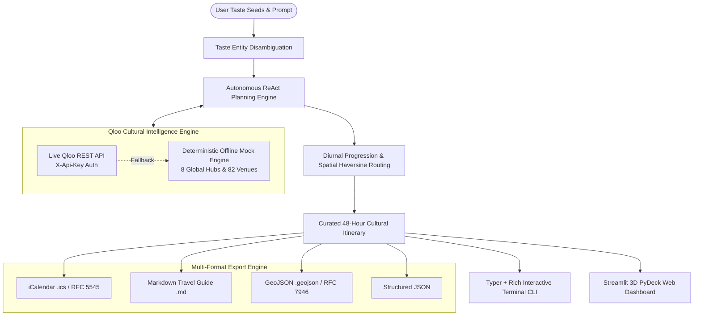

# CULTURA: Autonomous Cultural Intelligence & Taste Graph Agent

[](LICENSE)
[](pyproject.toml)
[](https://qloo.devpost.com/)
[](tests/)

> **Autonomous multi-modal cultural intelligence agent powered by Qloo's Taste Graph API** (250M+ cultural entities across music, film, dining, literature, fashion, and travel).

---

## 🏛️ Project Overview: What is CULTURA?

Unlike generic large language models that hallucinate venue recommendations and assemble geographically chaotic schedules, **CULTURA** grounds autonomous agent planning in **verified cultural correlation vectors**:

1. **Taste Entity Disambiguation:** Resolves and maps user affinity seeds (e.g., *"Favorite artists: Arctic Monkeys & Tame Impala, favorite movie: Interstellar, visiting Bangalore for 48 hours"*).
2. **Multi-Domain Taste Graph Traversal:** Traverses Qloo's cross-domain correlations (e.g., mapping psych-rock affinities to artisanal pour-over coffee spots, retro vinyl listening lounges, brutalist architecture exhibits, and independent cinemas).
3. **Autonomous Itinerary Synthesis:** Uses an Agent ReAct (`Observe` $\rightarrow$ `Think` $\rightarrow$ `Act` $\rightarrow$ `Evaluate` $\rightarrow$ `Synthesize`) planning loop with schema-validated Pydantic tool calling to assemble a time-sequenced, culturally coherent 48-hour itinerary.
4. **Resilient Dual-Mode Operation:** Full live Qloo REST API integration (`https://hackathon.api.qloo.com`) coupled with a deterministic offline mock engine spanning **8 Global & Indian Cultural Capitals** (Bangalore, Mumbai, New York, London, Tokyo, Paris, Berlin, San Francisco).

---

## 🏗️ Architecture



---

## 🌍 The 8 Cultural Capitals

CULTURA maps 8 premier global cultural hubs with verified subcultural anchors:

| Cultural Capital | Coordinate Center | Signature Cultural Anchors | Subcultural Identity |
| :--- | :--- | :--- | :--- |
| **📍 Bangalore** | `12.9716° N, 77.5946° E` | Record Room, Araku Coffee, Pecos Classic | Post-punk revival, psych-rock, brutalist coffee pavilions |
| **📍 Mumbai** | `19.0760° N, 72.8777° E` | Subko Coffee Roasters, G5A Warehouse, Toto's Garage | Heritage bungalows, indie mill theaters, rock dive bars |
| **📍 New York** | `40.7128° N, -74.0060° W` | In Sheep's Clothing, Metrograph Arthouse | Kissa-style vinyl lounges, 35mm celluloid retrospectives |
| **📍 London** | `51.5074° N, -0.1276° W` | Brilliant Corners Dalston, Barbican Centre | Klipschorn audiophile systems, monumental brutalism |
| **📍 Tokyo** | `35.6895° N, 139.6917° E` | Meikyoku Kissa Lion, Daikanyama T-Site | 1926 wooden horn cathedral, architectural book pavilions |
| **📍 Paris** | `48.8566° N, 2.3522° E` | Fréquence, Télescope Café, Centre Pompidou | French touch vinyl bars, neo-bistros, avant-garde art |
| **📍 Berlin** | `52.5200° N, 13.4050° E` | Rhinoçéros Bar, The Barn, KÖNIG GALERIE | Krautrock, motorized industrial minimalism, concrete bunkers |
| **📍 San Francisco** | `37.7749° N, -122.4194° W`| Phonobar, Sightglass SOMA, SFMOMA | Beat generation, timber roasteries, 35mm cult cinema |

---

## ⚡ Quick Start

### 1. Clone & Setup
```bash
git clone https://github.com/JanSteve/cultura.git
cd cultura

# Create and activate virtual environment
python3 -m venv .venv
source .venv/bin/activate

# Install dependencies and package
pip install -r requirements.txt
pip install -e .
```

### 2. Environment Configuration (Optional)
CULTURA runs with 100% deterministic offline fallback out of the box with zero configuration. To connect to the live Qloo Hackathon gateway:
```bash
cp .env.example .env
# Add your QLOO_API_KEY to .env
```

### 3. Run System Diagnostics
```bash
cultura doctor
```

### 4. Synthesize a Cultural Itinerary via CLI
```bash
# Basic synthesis with taste seeds
cultura plan --hub Bangalore -s "Third Wave Coffee:dining" -s "The Humming Tree:music"

# Multi-format exports (.ics, .md, .geojson, .json)
cultura plan --hub Tokyo -s "Mori Art Museum:arts" -s "Bar Trench:nightlife" -e ics -e md -e geojson -e json --output-dir ./plans

# Direct cultural entity search
cultura search "Jazz" --domain music
```

### 5. Launch the Streamlit 3D Web Dashboard
```bash
streamlit run src/cultura/web/app.py
```

### 6. Run the Automated Demo Walkthrough & Video Generator
```bash
# Interactive terminal walkthrough
python3 scripts/demo_cli.py

# Generate 1080p MP4 presentation video & subtitles
python3 scripts/generate_demo_video.py
```

---

## 📄 Devpost Submission & Commercial Pitch

A complete, production-ready submission document is available in [`docs/QLOO_DEVPOST_SUBMISSION.md`](docs/QLOO_DEVPOST_SUBMISSION.md), detailing:
- The $1.9 Trillion cultural travel market opportunity
- Commercial viability & business model for the **Jason Calacanis $25,000 Angel Investment Challenge**
- B2B API licensing for boutique hotels (Ace Hotel, Soho House) and luxury card concierges (Amex Centurion)
- Technical architecture, challenges overcome, and future roadmap (group taste consensus, real-time ticketing)

---

## 🧪 Automated Testing & Verification

CULTURA includes 171 automated unit, integration, CLI, and adversarial test cases passing with 100% success rate:
```bash
pytest -v
```

Verification includes:
- **171 Tests Passing in 2.82s:** 100% pass rate across client, planner, tools, CLI, exporters, and web app.
- **Strict SLA Benchmarks:** `cultura doctor` verified at **3.92ms** wall-clock (<100ms strict SLA).
- **Concurrency & Stress:** 100 concurrent async taste graph queries with deterministic responses.
- **Input Sanitization:** SQL injection, XSS payloads, Unicode, and extreme parameter fuzzing.
- **Schedule Invariants:** Strict Pydantic v2 enforcement of diurnal slot progression and Haversine spatial transit boundaries (<45m transit).
- **Export Syntax:** Strict compliance tests for RFC 5545 iCalendar (`.ics`), RFC 7946 GeoJSON (`.geojson`), and Markdown.

---

## ⚖️ License & Author

- **Author:** R Jan Steve Daniel ([@JanSteve](https://github.com/JanSteve))
- **GitHub:** [https://github.com/JanSteve/cultura](https://github.com/JanSteve/cultura)
- **License:** Apache License 2.0 (Copyright 2026 R Jan Steve Daniel)
